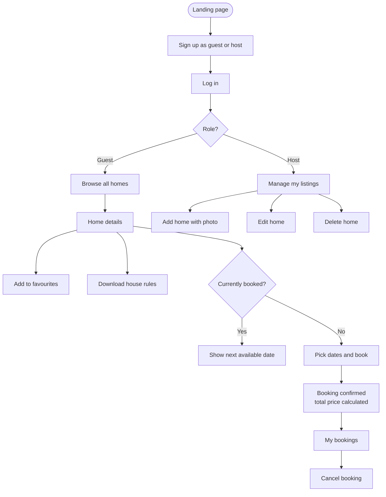
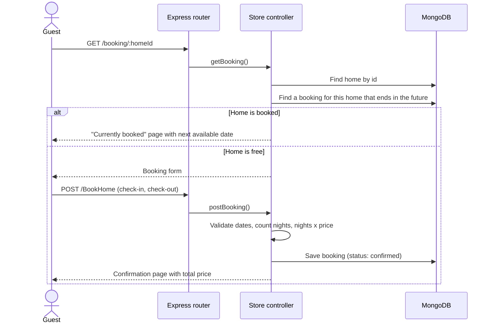
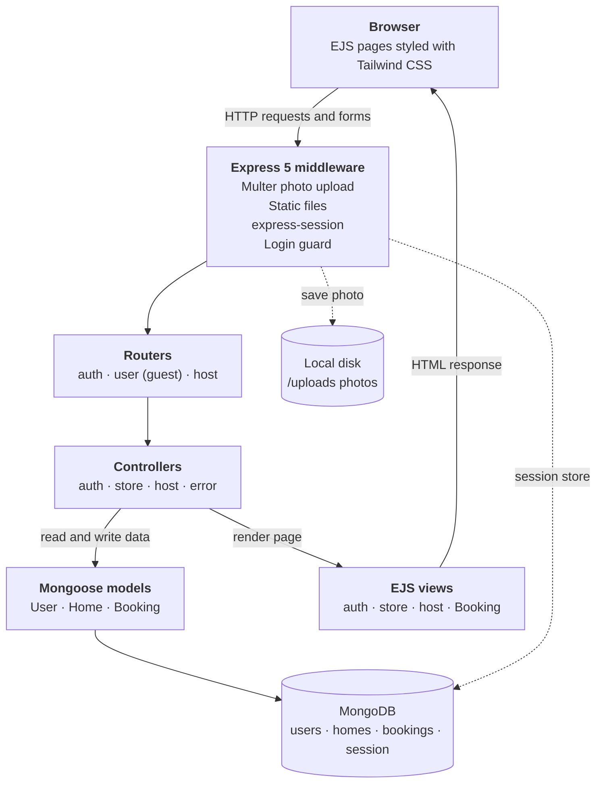
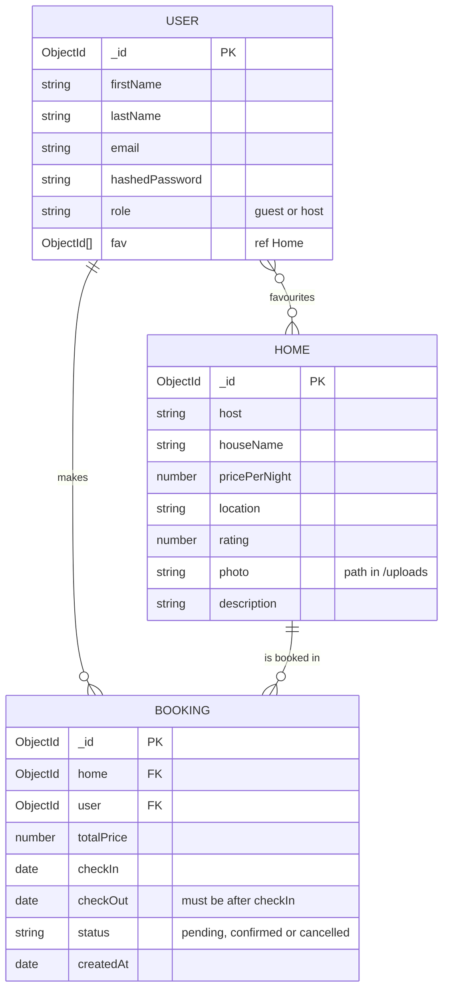

<div align="center">

<h1>StaySphere</h1>

<p><b>A full-stack rental marketplace for guests and hosts</b></p>

<p><i>List a home, discover a stay, book your dates. Built with Node.js, Express, MongoDB and EJS.</i></p>


**Guests browse homes, save favourites and book stays with automatic price calculation.<br>Hosts list properties with photos and manage them from their own dashboard.**

[Features](#features) · [How It Works](#how-it-works) · [Architecture](#architecture) · [Getting Started](#getting-started) · [Routes](#routes) · [Roadmap](#roadmap)

</div>

---

## Overview

**StaySphere** is an Airbnb-style rental marketplace built on the classic **MVC** pattern with server-side rendering. A single sign-up form creates either a **guest** or a **host** account, and the interface adapts to that role:

- **Guests** explore every listed home, open its detail page, add it to their favourites, check availability and book a stay. The total price is calculated from the number of nights. Guests can also view and cancel their bookings and download the house rules as a PDF.
- **Hosts** add new listings with a photo upload, see all listings in a management view, edit details or replace the photo, and delete listings.

Sessions are stored in **MongoDB**, so users stay logged in across server restarts. Passwords are hashed with **bcrypt**, and every sign-up field is validated on the server with **express-validator**.

## Features

| Feature | How it works |
|---|---|
| **Role-based accounts** | Users sign up as a guest or a host. The navigation bar and available pages change based on the role stored in the session. |
| **Secure authentication** | Passwords are hashed with bcrypt (10 salt rounds). Login compares the hash and creates a session. Logout destroys it. |
| **Strong sign-up validation** | express-validator checks name format, email, matching passwords and password strength (8+ characters, upper and lower case, a number and a special character), and requires accepting the terms. Errors are shown with the user's previous input kept in the form. |
| **Persistent sessions** | `express-session` with `connect-mongodb-session` stores sessions in a MongoDB collection, so logins survive server restarts. |
| **Route protection** | A global middleware lets only `/`, `/login` and `/signup` through without a session. Every other page redirects to login. |
| **Listings with photos** | Hosts upload a property photo with Multer. Images are saved to `/uploads` and served as static files. |
| **Host dashboard** | Add, edit (including replacing the photo) and delete listings. |
| **Browse and details** | Guests see all homes as cards with price per night, location and rating, and can open a full detail page. |
| **Favourites** | Guests save homes to a personal favourites list. Duplicates are prevented, and the list is kept in sync between the database and the session. |
| **Booking engine** | Guests choose check-in and check-out dates. The server validates the dates, counts the nights, calculates the total price and saves a confirmed booking. |
| **Availability check** | If a home already has a booking that hasn't ended yet, guests see that it's booked along with the next available date. |
| **My bookings** | Guests can view their booking with full home details and cancel it. |
| **House rules download** | Logged-in guests can download a house rules PDF from any listing. |
| **Custom 404 page** | Unknown routes render a friendly "page not found" view. |

## How It Works

### User journey



### Booking a stay, step by step



## Architecture



**Design highlights**

- **MVC separation.** Routes only map URLs, controllers hold the logic, Mongoose models define the data, and EJS views render the pages.
- **Server-side rendering.** Every page is rendered on the server with EJS and shared partials (header, footer), so no frontend framework is needed.
- **Session-based auth.** The user object (with ids converted to strings) is stored in the session, which gives every controller fast access to the user's id, role and favourites.
- **Schema-level validation.** The Booking model itself rejects a check-out date that isn't after the check-in date, as a second line of defence behind the controller check.

## Data Model



## Tech Stack

| Layer | Technology |
|---|---|
| Runtime | Node.js |
| Web framework | Express 5 |
| Database | MongoDB with Mongoose 9 |
| Views | EJS templates with shared partials |
| Styling | Tailwind CSS 4 (CLI build) |
| Authentication | express-session, connect-mongodb-session, bcrypt |
| Validation | express-validator |
| File uploads | Multer |
| Dev tooling | nodemon, dotenv |

## Project Structure

```
StaySphere/
├── app.js                    # Express setup, middleware, session store, login guard
├── Routes/
│   ├── auth.js               # Login, sign-up, logout
│   ├── user.js               # Guest routes: browse, details, favourites, bookings
│   └── host.js               # Host routes: add, edit, delete, list homes
├── controller/
│   ├── auth.js               # Authentication and sign-up validation
│   ├── store-controller.js   # Guest features and the booking engine
│   ├── host-controller.js    # Listing management
│   └── error.js              # 404 handler
├── Model/
│   ├── user.js               # User schema with role and favourites
│   ├── home.js               # Home listing schema
│   └── booking.js            # Booking schema with date validation
├── views/
│   ├── partials/             # Header (role-based nav), footer
│   ├── auth/                 # Login and sign-up pages
│   ├── store/                # Landing, home list, details, favourites
│   ├── host/                 # Add, edit and manage listings
│   ├── Booking/              # Booking form, confirmation, booked, my bookings
│   ├── 404.ejs
│   └── input.css             # Tailwind source
├── public/
│   ├── output.css            # Compiled Tailwind CSS
│   └── HOUSE RULES.pdf       # Downloadable house rules
├── uploads/                  # Uploaded listing photos
├── utils/
│   ├── database.js           # MongoDB connection
│   └── utils.js              # Project root path helper
└── package.json
```

## Getting Started

### Prerequisites

- **Node.js 18+** and npm
- A **MongoDB** database: local, or a free cluster on [MongoDB Atlas](https://www.mongodb.com/atlas)

### 1. Clone and install

```bash
git clone https://github.com/Ashwin-Laad/StaySphere-Full-Stack-Rental-Marketplace-Platform.git staysphere
cd staysphere
npm install
```

### 2. Configure environment variables

Create a `.env` file in the project root:

```env
MONGO_URI=mongodb+srv://<user>:<password>@<cluster>/staysphere
PORT=3000
```

### 3. Run the app

```bash
npm start
```

This starts the server with **nodemon** and runs the **Tailwind CSS** watcher at the same time. Open [http://localhost:3000](http://localhost:3000).

> **On Windows,** `npm start` may not run both commands, because it chains them with `&`. Run them in two terminals instead:
>
> ```bash
> npx nodemon app.js
> npm run tailwind
> ```

### 4. Try it out

1. Sign up as a **host**, log in, and add a home with a photo.
2. Log out, sign up as a **guest**, and browse the listings.
3. Add a home to your favourites, then book it for a few nights.
4. Open **My Bookings** to see the booking and cancel it.

### Available scripts

| Command | Description |
|---|---|
| `npm start` | Run the server with nodemon and the Tailwind watcher |
| `npm run tailwind` | Rebuild `public/output.css` whenever styles change |

## Routes

### Authentication

| Method | Route | Description |
|---|---|---|
| `GET` | `/signup` | Sign-up form (choose guest or host) |
| `POST` | `/signup` | Validate input, hash the password and create the user |
| `GET` | `/login` | Login form |
| `POST` | `/login` | Check credentials and start a session |
| `POST` | `/logout` | Destroy the session |

### Guest

| Method | Route | Description |
|---|---|---|
| `GET` | `/` | Landing page |
| `GET` | `/home-list` | Browse all homes |
| `GET` | `/home-detail/:homeId` | Home details |
| `GET` | `/favorite` | View favourites |
| `POST` | `/favorite` | Add a home to favourites |
| `POST` | `/delete-fav` | Remove a home from favourites |
| `GET` | `/booking/:homeId` | Check availability and open the booking form |
| `POST` | `/BookHome` | Create a booking and show the confirmation |
| `POST` | `/user/booking` | View my bookings |
| `POST` | `/booking/cancel/:bookingId` | Cancel a booking |
| `GET` | `/store/rule/:homeId` | Download the house rules PDF |

### Host

| Method | Route | Description |
|---|---|---|
| `GET` | `/host-home-list` | Manage listings |
| `GET` | `/add-home` | New listing form |
| `POST` | `/add-home` | Create a listing with a photo |
| `GET` | `/host/edit-home/:homeId` | Edit listing form |
| `POST` | `/edit-home` | Save listing changes |
| `POST` | `/host/delete-home/:homeId` | Delete a listing |


## Contributing

Contributions, issues and suggestions are welcome.

1. Fork the repo
2. Create a branch: `git checkout -b feature/your-feature`
3. Commit your changes: `git commit -m "Add your feature"`
4. Push and open a Pull Request

## Author

**Ashwin Laad**: [@Ashwin-Laad](https://github.com/Ashwin-Laad)


---

<sub>Built to explore full-stack web development with Node.js, Express, MongoDB and server-side rendering.</sub>
